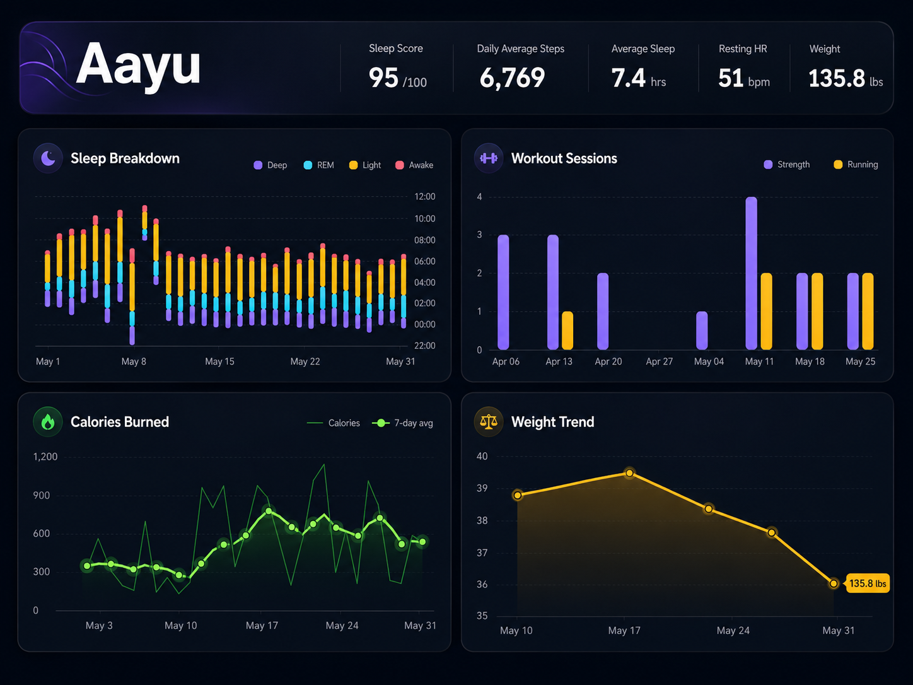

# Aayu — Personal Health Dashboard

A native Mac app (Apple Silicon) for wearable data exported from the **Zepp**
app (Amazfit devices). Point it at your Zepp export folder and it charts your
sleep, workouts, calories and weight.



One window: a greeting and month control (‹ ›, ⌘← ⌘→, plus **Last 30 days**),
your **sleep score** with the month's sleep-stage mix, tiles for steps, sleep,
resting heart rate and weight (each compared with the month before), and four
charts — a night-by-night **Sleep Breakdown** (hypnogram), **Workout
Sessions**, **Calories Burned** and **Weight Trend** — with hover details.

## Install

Needs [uv](https://docs.astral.sh/uv/) and the Xcode Command Line Tools
(`xcode-select --install`); full Xcode isn't required.

```bash
git clone <repo-url> && cd aayu
make install        # builds Aayu.app and copies it to /Applications
```

Or `make app` to build `dist/Aayu.app` without installing, and `make run` to
run a debug build from source.

## Use

1. Export your data from the Zepp app and unzip it.
2. Open Aayu, click **Choose Zepp Folder…** and pick the unzipped folder (the
   one containing `SLEEP/`, `ACTIVITY/`, `BODY/`, …).
3. If the folder is in Documents, Desktop or Downloads, macOS asks once whether
   Aayu may access it — click **Allow**.

Settings (⌘,):

| Setting | What it does |
| --- | --- |
| Zepp data folder | Where your export lives. Shows which data types were found. |
| Reload when a new export appears | Picks up a new export automatically. ⌘R reloads by hand. |
| Weight units | lbs or kg, for the KPI and the weight chart. |
| Open on | Start on the latest month or the last 30 days. |

## How it's built

A SwiftUI app with Swift Charts in front of a Python (pandas) backend. The app
starts the backend as a hidden helper and they exchange JSON over a private
pipe — no network port, nothing else on your Mac can read the data.

```
app/                    # SwiftUI front end (Swift package)
  Sources/Aayu/         #   views, charts, settings, Backend (the pipe)
  Info.plist
backend/aayu_backend/   # Python backend
  data.py               #   CSV loading, cleaning, KPI values
  series.py             #   the numbers behind each chart
  server.py             #   JSON-lines protocol + folder watcher
scripts/
  bundle.sh             #   assembles + signs Aayu.app
  make_icon.py          #   draws the app icon
Makefile                # run / app / install / clean
```

## Data Privacy

Everything stays on your Mac: the app reads only the folder you choose and
makes no network requests. `data/` is gitignored, so health data you keep in
the repo is never committed.
